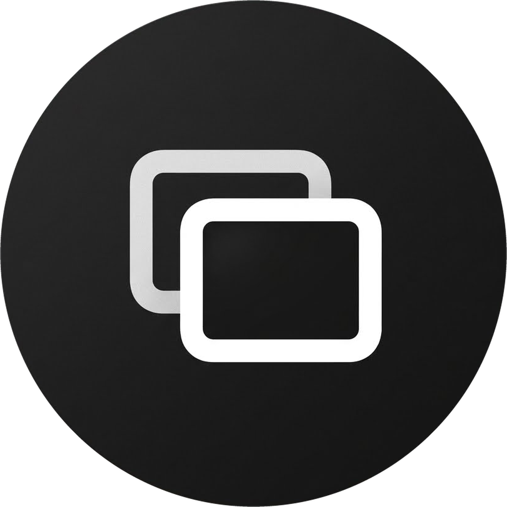

<p align="center">
  
</p>

<h1 align="center">3zT Mirroring</h1>

<p align="center">
  Mirror and control your iPhone, iPad or Android phone on a Windows PC, over the cable or Wi-Fi.
</p>

<p align="center">
  <a href="https://github.com/abogzah559-wq/3zT-Mirroring/releases/latest"></a>
  
  <a href="LICENSE"></a>
  <a href="https://7krh-hub.pages.dev/en/support/"></a>
</p>

## Features

- **iPhone and iPad** over USB or Wi-Fi, with sound.
- **Control from the PC** — mouse as touch, scrolling, Home / App Switcher /
  Control Center buttons, and the PC keyboard as a hardware keyboard,
  including **Arabic typing**.
- **Android** over USB or Wi-Fi with picture, sound (Android 11+), mouse and
  keyboard control, clipboard and drag-and-drop of files and APKs.
- **Clean view** — while mirroring, the window is only the device screen.
  Press **F2** to show or hide the controls; they appear around the picture,
  never on top of it. `Alt` + drag moves the window.
- Hardware video decoding, a capture-friendly window for OBS, OCR copy of the
  device screen, and a soft-black interface.
- **One installer** — everything the app needs is inside Setup. Apple's USB
  driver is downloaded from Apple and installed for you when it is missing.
- **Signed updates** — the app tells you when a new version is out; one click
  downloads it, checks its SHA-256 and release signature, and installs it.

## Requirements

- Windows 10 (1809 or newer) or Windows 11, 64-bit.
- **iPhone / iPad picture:** any iOS version that supports Screen Mirroring.
- **iPhone / iPad control:** iOS 17 or newer with **Developer Mode** on.
  Connect the cable, tap **Trust This Computer**, then
  **Settings › Privacy & Security › Developer Mode › On** and restart the
  device. After the first cable connection, control also works over Wi-Fi.
  - iOS 27 and newer: picture and control both come over Apple's own channel.
  - iOS 17 – 26: the picture comes over AirPlay (PC and device on the same
    Wi-Fi) and control over Apple's driver.
- **Android:** Android 5.0+ with **USB debugging** on. Sound needs Android 11+.

## Install

1. Download `3zT-Mirroring-v<version>-Setup.exe` from
   [Releases](https://github.com/abogzah559-wq/3zT-Mirroring/releases/latest).
2. Run it. Setup installs the app, Apple Mobile Device Support (if missing)
   and a Windows Firewall rule for Wi-Fi mirroring.
3. Open **3zT Mirroring** and pick iPhone/iPad or Android.

## Use

| Action | How |
| :--- | :--- |
| Show / hide the controls | `F2` |
| Move the window in the clean view | `Alt` + drag the picture |
| Full screen | `F11` (`Esc` to leave) |
| Settings | `Ctrl + ,` |
| Switch the device keyboard (English / Arabic) | `Alt + G` |
| Copy the text on the device screen (OCR) | `Alt + C` |
| Back / Home / Control Center | `Alt + ←` · dock buttons · `Alt + Q` |
| Sound on the PC on / off | `Alt + M` |

**Arabic typing on iPhone / iPad:** on the device keep two keyboards,
English and Arabic, then open **Settings › General › Keyboard › Hardware
Keyboard › Arabic** and choose **Arabic – PC**. Type with the Windows Arabic
(101) layout; 3zT Mirroring switches the device keyboard between English and
Arabic as you type. If the two ever disagree, press `Alt + G` once.

**Connection trouble:** press **Restart** in the header. A Wi-Fi session that
goes silent is closed by itself after a minute, so the next attempt starts
clean. If an iPhone keeps failing over Wi-Fi, turn Screen Mirroring off on
the device, press Restart, and pick **3zT Mirroring** again.
Logs are in `%LOCALAPPDATA%\3zT Mirroring\logs`.

## Build from source

Requirements: Rust (stable), Python 3.13, Inno Setup 6.6+, MSYS2 (UCRT64
gcc) and Visual Studio C++ build tools for the native DLLs, and Google's
platform-tools (adb) for Windows. The steps match
`.github/workflows/build.yml`.

```powershell
# Native DLLs (see native\aacdec, native\videodec and native\playfair)
#   MSYS2: bash native/build_ffmpeg.sh <ffmpeg-9.0.2-src> <build-dir> <prefix>
#          bash native/aacdec/build_aacdec.sh <prefix> mirroring 2.0.1
#          bash native/videodec/build_videodec.sh <prefix> native/out 2.0.1
native\playfair\build.bat
# The scrcpy server is pinned in third_party\scrcpy (see SHA256SUMS.txt)
Invoke-WebRequest https://github.com/Genymobile/scrcpy/releases/download/v5.0.1/scrcpy-server-v5.0.1 `
  -OutFile third_party\scrcpy\scrcpy-server-v5.0.1
powershell -ExecutionPolicy Bypass -File packaging\build.ps1 -PlatformTools C:\path\to\platform-tools
```

The installer is written to `release\`. Release builds are made by GitHub
Actions (`.github/workflows/build.yml`) and signed for the in-app updater.

## License

3zT Mirroring is free software under the
[GNU General Public License v3.0 or later](LICENSE) and comes with ABSOLUTELY
NO WARRANTY. It is based on [ZenLink](https://github.com/zenvyzenshiro/zenlink)
by Zenvy Zenshiro and other open-source projects; see
[THIRD_PARTY_NOTICES.md](THIRD_PARTY_NOTICES.md) for credits and licences.

iPhone, iPad, iOS and AirPlay are trademarks of Apple Inc. Android is a
trademark of Google LLC. 3zT Mirroring is not affiliated with Apple or Google.
